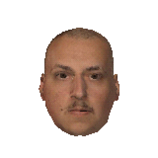

# Marc-Alexis Manso-Peters

Engineering student at EFREI Paris (M1 Robotics & Embedded Systems),
currently a robotics intern at Kyber™.

I'd rather understand a thing than just use it, so I build my own tools:

- **[kishot](https://github.com/marc-alexis-com/kishot)**: presentation sheets
  of a KiCad board, from the command line.
- **[nothing-toolbox](https://github.com/marc-alexis-com/nothing-toolbox)** and
  **[laifen-toolbox](https://github.com/marc-alexis-com/laifen-toolbox)**:
  Linux CLIs for my headphones and my toothbrush, over Bluetooth LE.
- **[change-in-line.nvim](https://github.com/marc-alexis-com/change-in-line.nvim)**:
  a small Neovim plugin I use daily.

My website pretends to be a PlayStation 2: **[marc-alexis.com](https://marc-alexis.com)**.
The head on the right lives there. Click it.

*Fun stuff: an NFC implant in my hand, and an autobiography nobody should buy.*
